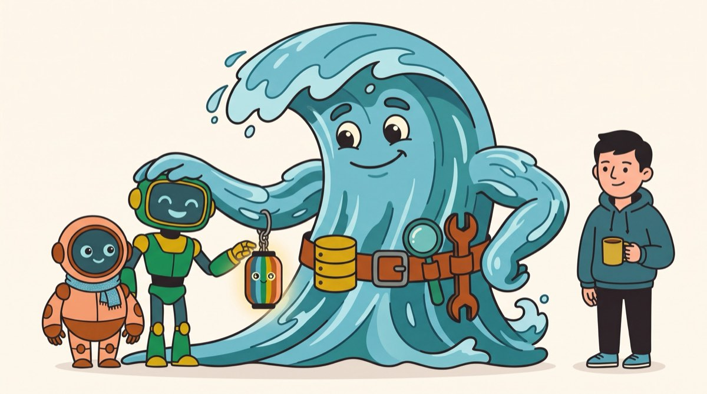

**The BEAM accessory for agents, by agents.**


Insider is a runtime-evidence library for BEAM applications, built for coding
agents. Today you use it in local development: it attaches to a running node,
records a bounded, masked window of what the node did, and gives your agent
that evidence as structured events, request traces and process snapshots.

## What it gives your agent

- **No restart.** Attach over Erlang distribution to a node that has a name,
  or through Tidewave `project_eval`. The app does not depend on Insider: the
  observer loads it at run time.
- **One evidence window.** Logger, Telemetry, OpenTelemetry, processes and the
  VM go into one bounded session. Every read says what was lost. Values with
  a credential's key name or shape are masked in every disclosure profile.
- **Facts the database does not keep.** Who sent a mutation, with which
  arguments and which user agent. When you name the function that writes an
  in-memory value (`--watch-write`), also which request changed it.
- **It answers while the app is stuck.** Insider reads over Erlang
  distribution, so it keeps working when the HTTP request path is stalled and
  tools behind that path wait in the same queue.
- **One quiet window per task.** `mark`, act, then read with `--since-mark`.
  In our own trials, agents chose marks as their per-task window on their own.
- **Room for several agents.** Named readers share one session, each with its
  own cursor and view.
- **A picture for the programmer you pair with.** `chart --serve` shows
  requests, waits, errors and your marks over time on a local page that
  refreshes every second; `chart` writes the same page as one HTML file.

## Quick start

Install the observer CLI from Hex and put the directory Mix prints on your
`PATH`. Your app needs no change: the observer loads Insider into the node.
Start a dev node with `--sname my_app` and a cookie file made under
`umask 077`. Replace `ID` with the `session_id` that `start` returns.

```sh
mix escript.install hex insider_lab
N=(--node "my_app@$(hostname -s)" --cookie-file "$HOME/.my_app.cookie")
insider-lab live capabilities "${N[@]}" --load   # first contact
insider-lab live welcome "${N[@]}"              # the agent's quick start
insider-lab live start "${N[@]}" --component logger --component telemetry
insider-lab live mark "${N[@]}" --session ID --label 'about to click Confirm'
insider-lab live digest "${N[@]}" --session ID --since-mark --human
insider-lab live events "${N[@]}" --session ID --cursor 0 --format compact
insider-lab live stop "${N[@]}" --session ID    # read the cleanup receipt
```

Then point your agent at the welcome document and let it drive. Found
something wrong? `insider-lab live report --category bug --message '…'`
files it locally. [Getting started](docs/getting-started.md) has the boot
command and the Tidewave variant. The [cheat sheet](docs/cheat-sheet.md)
has the commands you use most.

**Two packages, one version.** `insider_lab` is the CLI: the `insider-lab`
escript and the Mix tasks such as `mix insider.live`. Install it as above
to observe a node. Most people need only this, and the app needs no
dependency. `insider` is the core library that the CLI loads into the
node. Add `{:insider, "~> 0.1", only: :dev}` to your app only for its
agents (the usage rules and guides in `deps/insider/`) or for Tidewave
`project_eval`. The core has no Mix tasks, so `mix insider.live` in your
app reports that the task could not be found: run `insider-lab live`
instead. The two packages always release at the same version.

## When to reach for it

- **The fact exists only on a live request.** For example the client that
  sent a mutation, or the request that changed a watched in-memory value.
- **The request path is stalled.** Process state still answers over
  distribution.
- **You want one trace across a frontend server and the BEAM.** With the
  loopback OTLP receiver, a server-rendered page's spans and the backend spans
  form one tree.
- **You want a quiet window per task.** Mark, reproduce, then read only the
  events since the mark.

## When not to

- **The evidence is still there afterwards.** Use SQL, the dev log, a browser
  or a short test. In our trials these solved most bugs as fast as
  Insider did.
- **You can name the state that triggers the bug.** Write a test that builds
  that state. It is quicker to prove and leaves a regression test.
- **Production.** Live observation is denied in staging and production. See
  below.

## Insider and Tidewave



Use Insider next to Tidewave, not instead of it. Tidewave evaluates code and
queries the database inside the node. Insider records what happened while
requests ran, and observes from outside the request path. In our trials,
Tidewave, dev logs and a browser decided most outcomes. Insider
supplied the deciding fact in a few: a request-only fact, or a stalled request
path.

## Status and safety

- **Early.** Version `0.1.4`. The protocol, APIs and package layout will
  change.
- **Dev, test and ci only.** The node's own environment decides, never the
  caller. Live observation is denied in staging and production until separate
  human decisions allow it: see the
  [production boundary](docs/disclosure-and-safety.md#production-boundary).
- **Your data.** Development and test default to the `rich` profile, which
  assumes your development data holds no real personal data. If it does, set
  `config :insider, :live_disclosure, :strict`.
- **A guest in your node.** Sessions are leased, bounded and cleaned up, and
  `stop` returns a cleanup receipt you can check.
- **OTP 28 or later** for call traces and OpenTelemetry capture. Elixir
  1.17/OTP 27 is the floor for the rest.

## Documentation

The [documentation index](docs/README.md) tells you, or your agent, which
section to read for which task. Start with
[Getting started](docs/getting-started.md) or the
[cheat sheet](docs/cheat-sheet.md). Contributors start with
[Development](docs/development.md).

## Community

- [`CONTRIBUTING.md`](https://github.com/hiivemarkets/insider/blob/main/CONTRIBUTING.md): setup, the quality gates, tests-first
  rules, and commit and pull request conventions. Contributors and coding
  agents also follow [`AGENTS.md`](AGENTS.md).
- [`CODE_OF_CONDUCT.md`](https://github.com/hiivemarkets/insider/blob/main/CODE_OF_CONDUCT.md): the Contributor Covenant 2.1.
- [`SECURITY.md`](https://github.com/hiivemarkets/insider/blob/main/SECURITY.md): supported versions, private vulnerability
  reporting, and what Insider's security promises cover.

## License

Insider is licensed under the MIT License. See [`LICENSE`](https://github.com/hiivemarkets/insider/blob/main/LICENSE). The
text under `LICENSES/` covers only the third-party code listed in
`THIRD_PARTY_NOTICES.md`.
